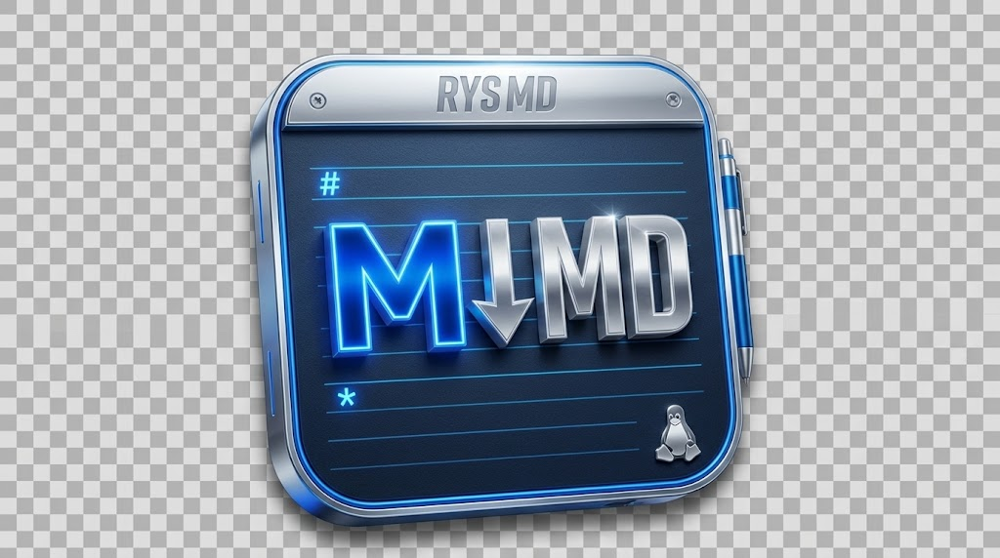
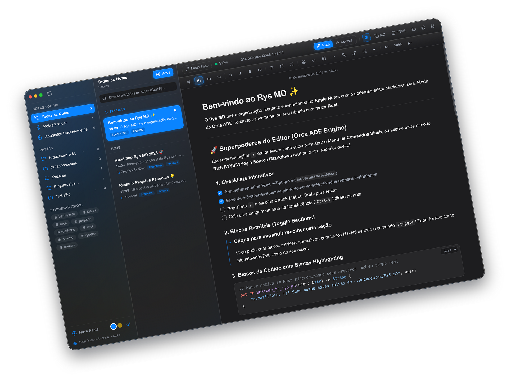
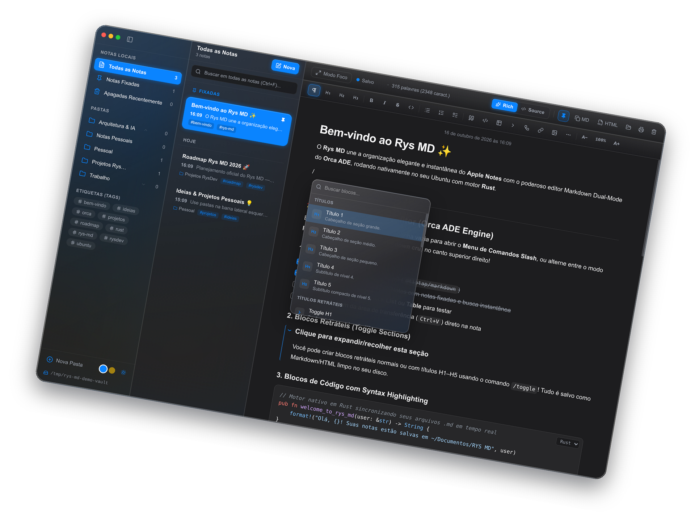
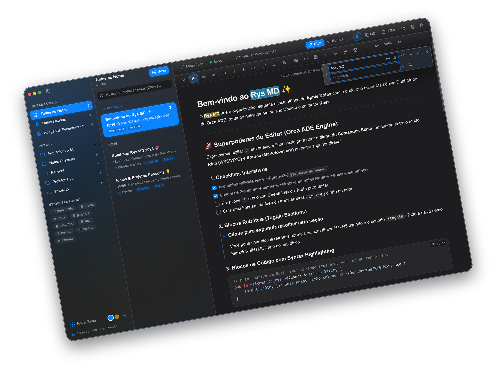
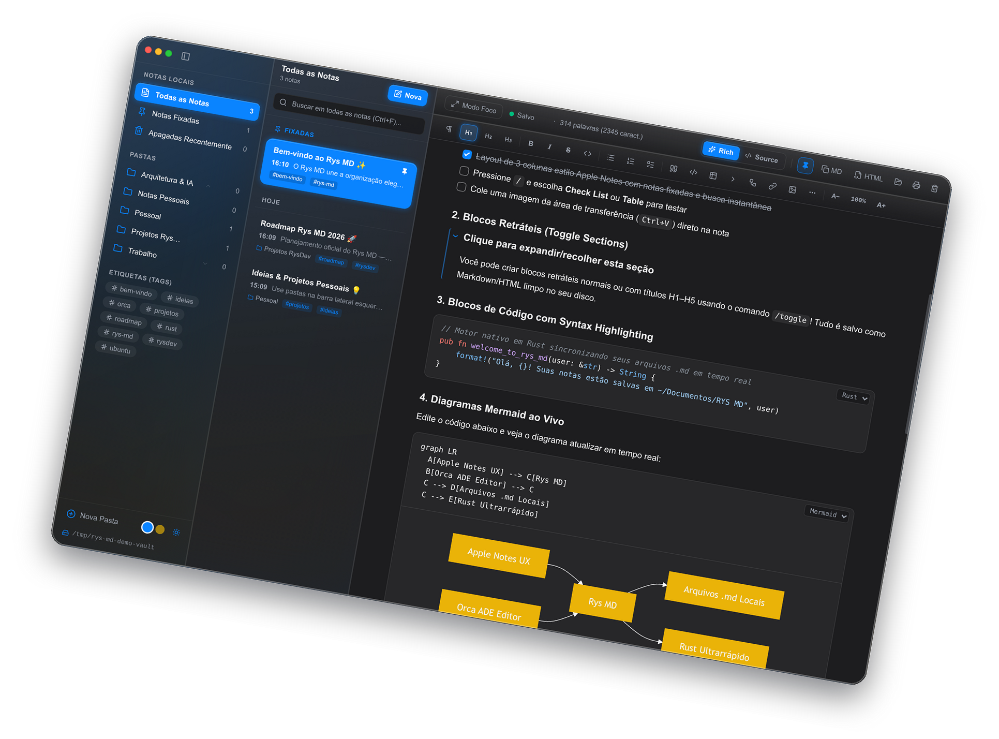
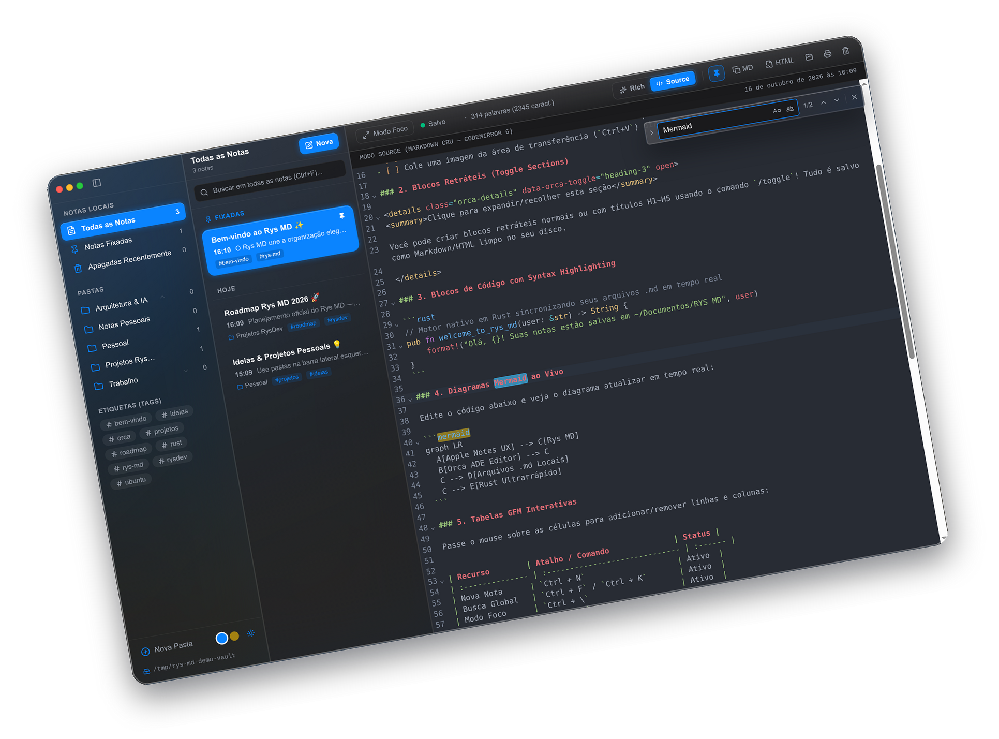
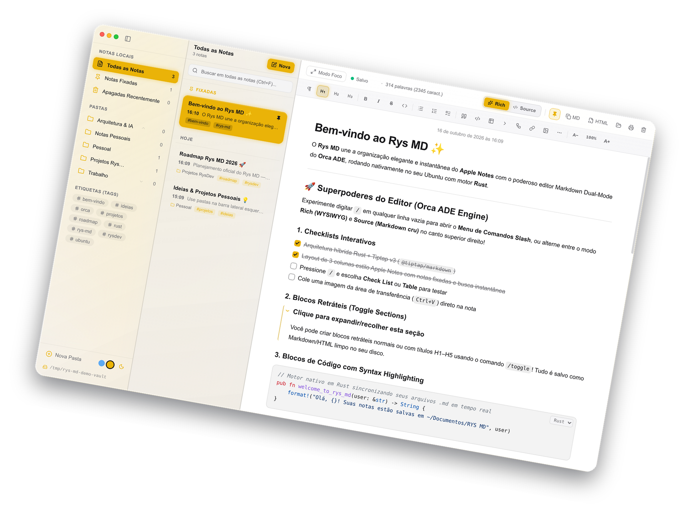

<div align="center">
  

  <h3>A fluidez e elegância Liquid Glass do Apple Notes unidas ao poder do editor Markdown Dual-Mode do Orca ADE — construído em Rust.</h3>

  <p>
    <a href="https://md.rysdev.com"><strong>🌐 md.rysdev.com</strong></a> •
    <a href="https://rysdev.com"><strong>RysDev</strong></a> •
    <a href="#-screenshots">Screenshots</a> •
    <a href="#-sobre-o-rys-md">Sobre</a> •
    <a href="#-principais-recursos">Recursos</a> •
    <a href="#-instalação--releases">Instalação</a> •
    <a href="#-atalhos-de-teclado">Atalhos</a>
  </p>
</div>

---

## 📸 Screenshots

> As capturas abaixo mostram o **Rys MD** em ação (tratadas com angulação de vitrine de 10º; as versões originais retas em alta resolução também estão disponíveis em [`docs/screenshots/raw/`](docs/screenshots/raw/)).

<table align="center">
  <tr>
    <td align="center" width="50%">
      
      <br />
      <sub><strong>1. Layout em 3 Colunas (Liquid Glass)</strong> — Pastas reordenáveis, notas fixadas e editor Rich.</sub>
    </td>
    <td align="center" width="50%">
      
      <br />
      <sub><strong>2. Menu de Comandos Slash (<code>/</code>)</strong> — Inserção rápida de blocos estilo Orca ADE.</sub>
    </td>
  </tr>
  <tr>
    <td align="center" width="50%">
      
      <br />
      <sub><strong>3. Busca & Substituição (<code>Ctrl + F</code>)</strong> — Localizar/substituir nativo no editor visual com destaque em tempo real.</sub>
    </td>
    <td align="center" width="50%">
      
      <br />
      <sub><strong>4. Mermaid ao Vivo & Código</strong> — Fluxogramas interativos, syntax highlighting e seções retráteis.</sub>
    </td>
  </tr>
  <tr>
    <td align="center" width="50%">
      
      <br />
      <sub><strong>5. Modo Source (CodeMirror 6)</strong> — Edição de Markdown cru em sincronia instantânea com o modo Rich.</sub>
    </td>
    <td align="center" width="50%">
      
      <br />
      <sub><strong>6. Personalização & Zoom</strong> — Modo Claro, cor de acentuação Amarelo Clássico e escala tipográfica global.</sub>
    </td>
  </tr>
</table>

---

## ✨ Sobre o Rys MD

O **Rys MD** ([md.rysdev.com](https://md.rysdev.com)) é um aplicativo desktop ultrarrápido de anotações e gestão de conhecimento pessoal desenvolvido por **ronysimao — [RysDev](https://rysdev.com)**.

Ele nasceu para resolver uma lacuna clássica no Linux, Windows e macOS: **como ter a organização instantânea em 3 colunas, o acabamento visual *Liquid Glass* e a simplicidade do Apple Notes, sem abrir mão de um editor Markdown profissional de nível engenharia?**

Para isso, o **Rys MD** combina:
1. **A UX/UI do Apple Notes (macOS)**: Layout de 3 colunas redimensionáveis e retráteis, estética *Liquid Glass*, bordas arredondadas nativas, controles de janela no canto superior esquerdo, reordenação livre de pastas (*Drag & Drop*), capitalização automática de início de frase, data completa de criação no topo da nota, cursor de edição luminoso mais espesso e escolha da cor de destaque (**Azul macOS** ou **Amarelo Clássico**).
2. **O Motor de Edição Rich Markdown do Orca ADE**: Edição híbrida **Dual-Mode** com sincronia bidirecional instantânea — alterne em tempo real entre o modo **Rich (WYSIWYG)** com suporte a comandos `/` (*Slash Menu*), busca e substituição integrada (`Ctrl + F` / `Ctrl + H`), tabelas interativas, diagramas **Mermaid**, fórmulas matemáticas **KaTeX**, seções retráteis (*Toggle Details*) e blocos de código com *syntax highlighting*, e o modo **Source (Markdown cru)** alimentado pelo **CodeMirror 6**.
3. **Motor Local-First em Rust**: Suas notas pertencem 100% a você e são salvas diretamente como arquivos `.md` puros na pasta local `~/Documentos/RYS MD`, com indexação instantânea e zero dependência de nuvem proprietária.

---

## 🚀 Principais Recursos

### 🗂️ Organização Estilo Apple Notes
- **Layout em 3 Colunas Redimensionáveis**:
  - **Coluna 1 (Pastas & Filtros — mín. 150px)**: Retrátil suavemente (ou recolhida automaticamente ao arrastar a divisória abaixo de 150px). Inclui *Todas as Notas*, *Notas Fixadas*, *Apagadas Recentemente*, árvore de *Notas Locais* com criação, exclusão e **reordenação de pastas**, *Drag & Drop* de notas entre pastas e filtragem automática por `#tags`.
  - **Coluna 2 (Lista de Notas — mín. 200px)**: Cartões com título, horário relativo, prévia limpa do conteúdo, indicador de pasta e busca global em todas as notas (`Ctrl + Shift + F`).
  - **Coluna 3 (Editor Dual-Mode — mín. 250px)**: Área de escrita focada com cabeçalho de ações rápidas, zoom proporcional de toda a nota (`A−` / `100%` / `A+`), rolagem além do fim da página (*scroll past end*) e modo foco.
- **Temas & Cores de Destaque**:
  - Alternância entre **Modo Escuro** e **Modo Claro**.
  - Escolha da cor dominante do aplicativo entre **Azul macOS (`#0a84ff`)** e **Amarelo Clássico (`#eab308`)**, refletida nos botões com brilho sutil, seleções e no cursor de texto.

### ✍️ Editor Rich Markdown (Orca ADE Engine)
- **Dual-Mode Real (`Rich` ⇄ `Source`)**: Edite visualmente com **TipTap v3 (`@tiptap/markdown`)** ou edite o código Markdown puro no **CodeMirror 6** com sincronização bidirecional imediata.
- **Busca e Substituição na Nota (`Ctrl + F` / `Ctrl + H`)**: Barra flutuante idêntica à do Orca ADE (`Buscar no editor visual`) funcionando tanto no modo **Rich** quanto no modo **Source**, com contador de ocorrências, diferenciação de maiúsculas/minúsculas (`Aa`), palavra inteira (`ab`) e substituição individual ou em lote.
- **Menu de Comandos Slash (`/`) & Emojis Nativos do SO**: Digite `/` em qualquer linha vazia e navegue pelo teclado para inserir títulos (`H1`–`H5`), checklists interativos (`- [ ]`), tabelas, blocos de código, citações, divisores, equações matemáticas, diagramas Mermaid, seções retráteis, imagens ou **Emojis** renderizados de acordo com o Sistema Operacional (Linux, macOS ou Windows).
- **Table of Contents (Heading Outline — mín. 150px)**: Painel lateral direito retrátil e redimensionável dentro da 3ª coluna que exibe a árvore hierárquica de escrita (`H1`–`H5`) com filtros por nível e navegação rápida.
- **Diagramas Mermaid & Matemática KaTeX**: Renderização visual ao vivo de fluxogramas/diagramas de sequência Mermaid e equações LaTeX (`$inline$` e `$$bloco$$`).
- **Imagens por Colagem Direta (`Ctrl+V`) ou Drag & Drop**: Cole prints diretamente da área de transferência; o motor em Rust salva o arquivo automaticamente em `assets/` dentro do cofre e insere a referência Markdown na nota.
- **Exportação para PDF (A4) & Cópia Rápida**: Exporte suas notas para **PDF formato A4** com tratamento inteligente de quebra de página e modal nativo do sistema pré-preenchido com `<Nome da Nota>.pdf`, ou copie como **Markdown puro** / **HTML compilado** (`text/html` + `text/plain`).
- **Auto-Update Estilo Orca ADE**: Verificação e atualização com 1 clique que fecha o programa, instala a nova versão e reabre automaticamente exatamente na nota em que você estava.

---

## 🛠️ Arquitetura & Stack

| Camada | Tecnologia | Papel no Rys MD |
| :--- | :--- | :--- |
| **Core / Backend** | **Rust** (`Tauri v2` + `tiny_http` / `walkdir`) | Leitura/escrita atômica de arquivos `.md`, gerenciamento de ativos (`assets/`), preservação de UUIDs em `.rys-index.json` e janela nativa Linux (`GTK3 + WebKit2GTK`), Windows (`WebView2`) e macOS (`WKWebView`). |
| **Frontend UI** | **React 19 + TypeScript + Tailwind CSS v4** | Interface reativa em 3 colunas com *Liquid Glass*, divisórias redimensionáveis e temas dinâmicos. |
| **Editor WYSIWYG** | **TipTap v3 + ProseMirror** | Serialização bidirecional Markdown, busca in-editor (`Ctrl+F`), Slash Menu, Table of Contents, tabelas com controles flutuantes, checklists e seções retráteis. |
| **Editor Source** | **CodeMirror 6** | Edição de Markdown cru com numeração de linhas, *code folding*, busca completa e *syntax highlighting*. |
| **Renderizadores** | **Mermaid v11 + KaTeX + Lowlight** | Diagramas técnicos, expressões matemáticas LaTeX e blocos de código coloridos. |

---

## 📦 Instalação & Releases

Os binários pré-compilados para **Linux** (`.deb` e `.AppImage`), **Windows** (`.exe` Instalador, `.msi` e `.exe` Portátil) e **macOS** (`.dmg` e `.app.tar.gz`) ficam disponíveis na aba **[Releases](https://github.com/ronysimao/rys-md/releases)** do repositório.

### 1. Instalar o Pacote `.deb` no Ubuntu / Debian / Linux Mint
```bash
sudo dpkg -i release/rys-md_0.7.0_amd64.deb
```
Depois de instalado, basta abrir **Rys MD** pelo menu de aplicativos do sistema ou executar `rys-md` no terminal.

### 2. Rodar em Modo de Desenvolvimento
Pré-requisitos: [Bun](https://bun.sh/) (ou Node.js 20+) e [Rust / Cargo](https://rustup.rs/).

```bash
# Instalar dependências
bun install

# Iniciar em modo de desenvolvimento
bun run dev
```

### 3. Gerar o Instalador `.deb` Localmente
```bash
bun run build:deb
```
O pacote instalável será gerado automaticamente em `release/rys-md_0.7.0_amd64.deb`.

---

## ⌨️ Atalhos de Teclado

| Atalho | Ação |
| :--- | :--- |
| `Ctrl + N` | Criar nova nota na pasta atual |
| `Ctrl + K` | Abrir **Busca Global** estilo daily.dev (Fuzzy Search em tags, títulos, pastas e conteúdo) |
| `Ctrl + F` | Buscar dentro da nota atual (modos **Rich** e **Source**) |
| `Ctrl + H` | Buscar e substituir dentro da nota atual |
| `Ctrl + Shift + F` | Abrir a **Busca Global** em todas as notas |
| `Ctrl + S` | Forçar salvamento imediato da nota |
| `Ctrl + +` / `Ctrl + =` | Aumentar zoom de toda a nota (Zoom In) |
| `Ctrl + -` | Diminuir zoom de toda a nota (Zoom Out) |
| `Ctrl + 0` | Restaurar zoom da nota para `100%` |
| `Ctrl + \` | Alternar Modo Foco (ocultar/mostrar barras laterais) |
| `Ctrl + B` / `Ctrl + I` | Negrito / Itálico |
| `Ctrl + Shift + X` | Tachado (*Strikethrough*) |
| `Ctrl + E` | Código Inline |
| `Ctrl + Shift + K` | Inserir ou editar Link |
| `/` | Abrir o Menu de Comandos Slash na linha atual |

---

## 📄 Licença & Atribuição Obrigatória

Este software é **aberto e gratuito para qualquer pessoa e para qualquer finalidade** (pessoal, acadêmica ou comercial), sob os termos da licença [LICENSE](./LICENSE) (**MIT com Atribuição Obrigatória**), desde que sejam expressamente citados como fontes:

1. **Autor / Fonte Original**: **ronysimao — RysDev** ([https://md.rysdev.com](https://md.rysdev.com) / [https://rysdev.com](https://rysdev.com))
2. **Motor de Edição Markdown**: **Orca ADE** ([https://github.com/stablyai/orca](https://github.com/stablyai/orca))

---

<div align="center">
  Desenvolvido com ❤️ e Rust por <strong>ronysimao — <a href="https://md.rysdev.com">RysDev (md.rysdev.com)</a></strong>
</div>
