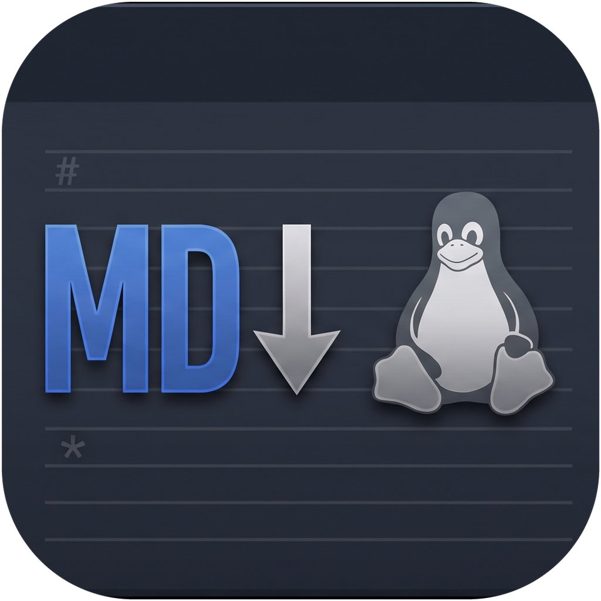
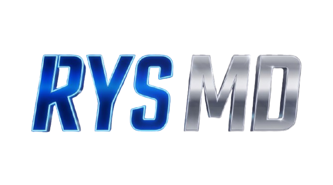

<div align="center">
  
  <br />
  

  <h3>A fluidez e elegância do Apple Notes unidas ao poder do editor Markdown Dual-Mode do Orca ADE — construído em Rust.</h3>

  <p>
    <a href="https://rysdev.com"><strong>🌐 rysdev.com</strong></a> •
    <a href="#-sobre-o-rys-md">Sobre</a> •
    <a href="#-principais-recursos">Recursos</a> •
    <a href="#-arquitetura--stack">Arquitetura</a> •
    <a href="#-instalação--compilação">Instalação</a> •
    <a href="#-atalhos-de-teclado">Atalhos</a>
  </p>
</div>

---

## ✨ Sobre o Rys MD

O **Rys MD** é um aplicativo desktop ultrarrápido de anotações e gestão de conhecimento pessoal desenvolvido pela **[RYS DEV](https://rysdev.com)**.

Ele nasceu para resolver uma lacuna clássica no Linux e no Windows: **como ter a organização instantânea em 3 colunas, o acabamento visual *Glassmorphism* e a simplicidade do Apple Notes do macOS, sem abrir mão de um editor Markdown profissional de nível engenharia?**

Para isso, o **Rys MD** combina:
1. **A UX/UI do Apple Notes (macOS)**: Layout de 3 colunas redimensionáveis e retráteis, efeito *Frosted Glass*, bordas arredondadas nativas, controles de janela estilo macOS no canto superior esquerdo, capitalização automática de início de frase, data completa de criação no topo da nota, cursor de edição luminoso mais espesso e personalização da cor de destaque (**Azul macOS** ou **Amarelo Clássico**).
2. **O Motor de Edição Rich Markdown do Orca ADE**: Edição híbrida **Dual-Mode** sem perda de formatação — alterne em tempo real entre o modo **Rich (WYSIWYG)** com suporte a comandos `/` (*Slash Menu*), tabelas interativas, diagramas **Mermaid**, fórmulas matemáticas **KaTeX**, seções retráteis (*Toggle Details*) e blocos de código com *syntax highlighting*, e o modo **Source (Markdown cru)** alimentado pelo **CodeMirror 6**.
3. **Motor Local-First em Rust**: Suas notas pertencem 100% a você e são salvas diretamente como arquivos `.md` puros na pasta local `~/Documentos/RYS MD`, com indexação instantânea e zero dependência de nuvem proprietária.

---

## 🚀 Principais Recursos

### 🗂️ Organização Estilo Apple Notes
- **Layout em 3 Colunas Redimensionáveis**:
  - **Coluna 1 (Pastas & Filtros — mín. 150px)**: Retrátil suavemente (ou recolhida automaticamente ao arrastar a divisória abaixo de 150px). Inclui *Todas as Notas*, *Notas Fixadas*, *Apagadas Recentemente*, árvore de *Notas Locais* com criação/exclusão de pastas, *Drag & Drop* de notas entre pastas e filtragem automática por `#tags`.
  - **Coluna 2 (Lista de Notas — mín. 200px)**: Cartões com título, horário relativo, prévia limpa do conteúdo, indicador de pasta e busca instantânea (`Ctrl+F`).
  - **Coluna 3 (Editor Dual-Mode — mín. 250px)**: Área de escrita focada com cabeçalho de ações rápidas, zoom de tipografia ajustável (`A−` / `100%` / `A+`) e modo foco.
- **Temas & Cores de Destaque**:
  - Alternância entre **Modo Escuro** e **Modo Claro**.
  - Escolha da cor dominante do aplicativo entre **Azul macOS (`#0a84ff`)** e **Amarelo Clássico (`#eab308`)**, refletida nos botões com brilho sutil, seleções e no cursor de texto.

### ✍️ Editor Rich Markdown (Orca ADE Engine)
- **Dual-Mode Real (`Rich` ⇄ `Source`)**: Edite visualmente com **TipTap v3 (`@tiptap/markdown`)** ou inspecione/edite o código Markdown puro no **CodeMirror 6** mantendo o *frontmatter* YAML intacto.
- **Menu de Comandos Slash (`/`)**: Digite `/` em qualquer linha vazia e navegue pelo teclado (com rolagem automática inteligente) para inserir títulos (`H1`–`H5`), checklists interativos (`- [ ]`), tabelas, blocos de código, citações, divisores, equações matemáticas, diagramas Mermaid, seções retráteis ou imagens.
- **Diagramas Mermaid & Matemática KaTeX**: Renderização visual ao vivo de fluxogramas/diagramas de sequência Mermaid e equações LaTeX (`$inline$` e `$$bloco$$`).
- **Imagens por Colagem Direta (`Ctrl+V`) ou Drag & Drop**: Cole prints diretamente da área de transferência; o motor em Rust salva o arquivo automaticamente em `assets/` dentro do cofre e insere a referência Markdown na nota.
- **Exportação Rápida**: Copie a nota inteira como **Markdown puro** ou como **HTML compilado** (`text/html` + `text/plain`) com um único clique no topo da nota.

---

## 🛠️ Arquitetura & Stack

| Camada | Tecnologia | Papel no Rys MD |
| :--- | :--- | :--- |
| **Core / Backend** | **Rust** (`Tauri v2` + `tiny_http` / `walkdir`) | Leitura/escrita atômica de arquivos `.md`, gerenciamento de ativos (`assets/`), preservação de UUIDs em `.rys-index.json` e janela nativa Linux (`GTK3 + WebKit2GTK`) / Windows (`WebView2`). |
| **Frontend UI** | **React 19 + TypeScript + Tailwind CSS v4** | Interface reativa em 3 colunas com *Glassmorphism*, divisórias redimensionáveis e temas dinâmicos. |
| **Editor WYSIWYG** | **TipTap v3 + ProseMirror** | Serialização bidirecional Markdown, Slash Menu, tabelas com controles flutuantes, checklists e seções retráteis. |
| **Editor Source** | **CodeMirror 6** | Edição de Markdown cru com numeração de linhas, *code folding* e *syntax highlighting*. |
| **Renderizadores** | **Mermaid v11 + KaTeX + Lowlight** | Diagramas técnicos, expressões matemáticas LaTeX e blocos de código coloridos. |

---

## 📦 Instalação & Compilação

### 1. Instalar o Pacote `.deb` no Ubuntu / Debian / Linux Mint
Se você já gerou ou baixou o pacote `.deb` em `release/rys-md_0.2.0_amd64.deb`:

```bash
sudo dpkg -i release/rys-md_0.2.0_amd64.deb
```

Depois de instalado, basta abrir **Rys MD** pelo menu de aplicativos do sistema ou executar `rys-md` no terminal.

### 2. Rodar em Modo de Desenvolvimento
Pré-requisitos: [Bun](https://bun.sh/) (ou Node.js 20+) e [Rust / Cargo](https://rustup.rs/).

```bash
# Instalar dependências
bun install

# Iniciar em modo de desenvolvimento
bun run dev
```

### 3. Gerar o Instalador `.deb` Localmente
```bash
bun run build:deb
```
O pacote instalável será gerado automaticamente em `release/rys-md_<versão>_amd64.deb`.

### 4. Build Multiplataforma (Linux `.deb` / `.AppImage` e Windows `.exe` Instalador / Portátil)
O projeto conta com configuração completa para **Tauri v2** (`src-tauri/`) e pipeline automatizado no GitHub Actions (`.github/workflows/release.yml`), gerando:
- **Linux**: `.deb` e `.AppImage`
- **Windows**: Instalador `x64-setup.exe` e executável portátil `Rys-MD-Portable-x64.exe`

---

## ⌨️ Atalhos de Teclado

| Atalho | Ação |
| :--- | :--- |
| `Ctrl + N` | Criar nova nota na pasta atual |
| `Ctrl + F` | Focar na barra de busca instantânea |
| `Ctrl + S` | Forçar salvamento imediato da nota |
| `Ctrl + +` / `Ctrl + =` | Aumentar tamanho da fonte da nota (Zoom In) |
| `Ctrl + -` | Diminuir tamanho da fonte da nota (Zoom Out) |
| `Ctrl + 0` | Restaurar tamanho da fonte para `100%` |
| `Ctrl + B` / `Ctrl + I` | Negrito / Itálico |
| `Ctrl + Shift + X` | Tachado (*Strikethrough*) |
| `Ctrl + E` | Código Inline |
| `Ctrl + K` | Inserir ou editar Link |
| `/` | Abrir o Menu de Comandos Slash na linha atual |

---

## 📄 Licença & Atribuição Obrigatória

Este software é **aberto e gratuito para qualquer pessoa e para qualquer finalidade** (pessoal, acadêmica ou comercial), sob os termos da licença [LICENSE](./LICENSE) (**MIT com Atribuição Obrigatória**), desde que sejam expressamente citados como fontes:

1. **Autor / Fonte Original**: **ronysimao — RysDev** ([https://rysdev.com](https://rysdev.com))
2. **Motor de Edição Markdown**: **Orca ADE** ([https://github.com/stablyai/orca](https://github.com/stablyai/orca))

---

<div align="center">
  Desenvolvido com ❤️ e Rust por <strong>ronysimao — <a href="https://rysdev.com">RysDev (rysdev.com)</a></strong>
</div>
